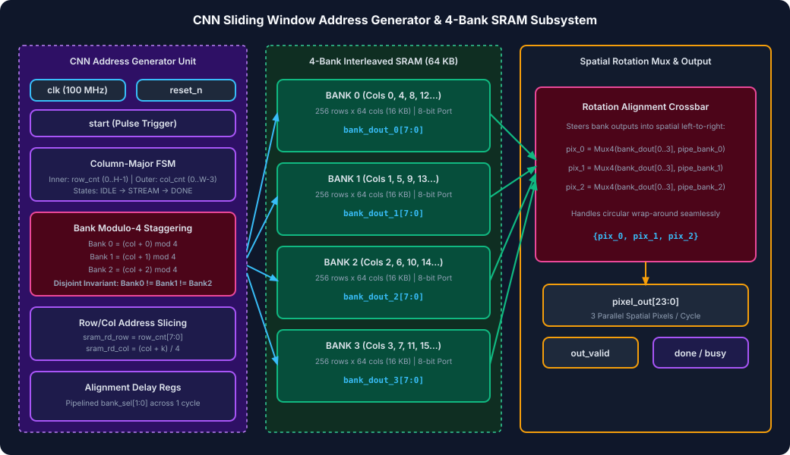
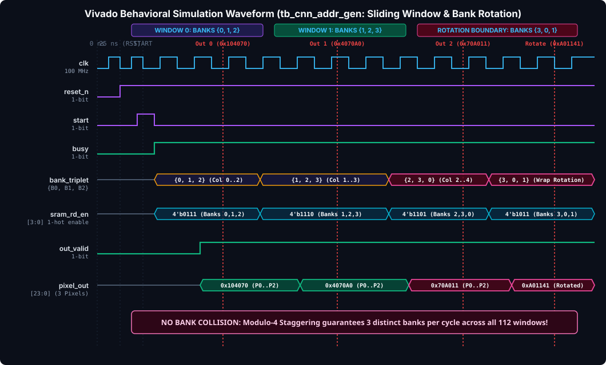

# Assignment 3: CNN Address Generator & 4-Bank Interleaved SRAM Subsystem

A synthesizable, hardware-optimized **CNN Sliding-Window Address Generator** and **4-Bank Interleaved SRAM Architecture** designed in IEEE 1364-2001 Verilog (`.v`). This subsystem enables single-cycle parallel access to a $3 \times 1$ horizontal pixel window across a 2D image matrix using column-interleaved multi-banking, eliminating bank conflicts during continuous 2D convolution sweeps.

> [!TIP]
> **To view the rich visual diagrams & formatted document in VS Code:**
> Press <kbd>Ctrl</kbd> + <kbd>Shift</kbd> + <kbd>V</kbd> (or <kbd>Ctrl</kbd> + <kbd>K</kbd>, then <kbd>V</kbd> to open side-by-side preview).

---

## 📖 Table of Contents
1. [Architectural Overview & Problem Statement](#-architectural-overview--problem-statement)
2. [Microarchitecture & Block Diagram](#-microarchitecture--block-diagram)
3. [Bank Interleaving & Collision-Free Invariant Proof](#-bank-interleaving--collision-free-invariant-proof)
4. [Spatial Rotation Alignment Crossbar](#-spatial-rotation-alignment-crossbar)
5. [Vivado Simulation Waveform Analysis](#-vivado-simulation-waveform-analysis)
6. [Source Files & Hierarchy](#-source-files--hierarchy)
7. [How to Run Vivado & CLI Simulations](#-how-to-run-vivado--cli-simulations)

---

## ⚙️ Architectural Overview & Problem Statement

In 2D Convolutional Neural Networks (CNNs), a sliding kernel requires fetching adjacent horizontal pixels (e.g., $3 \times 1$ window) every clock cycle. In a single-port standard SRAM, reading 3 pixels from the same memory block requires 3 clock cycles, introducing high memory latency stalls.

By interleaving image columns across **4 independent SRAM banks** ($\text{Bank ID} = \text{col} \pmod 4$):
- Any three consecutive columns $\{c, c+1, c+2\}$ map to **three distinct SRAM banks**.
- All three pixels are fetched **simultaneously in 1 clock cycle** with zero bank conflicts.

| Parameter | Specification | Description / Rationale |
| :--- | :--- | :--- |
| **HDL Standard** | IEEE 1364-2001 Verilog | Pure Verilog (`.v`), fully vendor neutral |
| **Image Resolution** | Configurable ($8 \times 16$ tested) | Scalable to $H \times W$ through Verilog `parameter` |
| **Kernel Window Size** | $3 \times 1$ horizontal window | Standard $3 \times 3$ CNN horizontal line buffer feed |
| **SRAM Banking** | 4 Interleaved Banks | Column modulo-4 bank distribution |
| **Bank Memory Size** | 256 rows $\times$ 64 columns (16 KB/bank) | Total 64 KB storage space |
| **Output Data Bus** | 24 Bits (`[23:0] pixel_out`) | Three 8-bit pixels presented in spatial left-to-right order |
| **Scan Order** | Column-Major Sliding Traversal | Optimizes vertical feature map reuse |
| **Throughput** | 1 Window / Clock Cycle | Sustained pipelined extraction with 0 stalls |

---

## 🏛️ Microarchitecture & Block Diagram



### Microarchitecture Details:
1. **Column-Major State Machine**:
   - Loops through all valid window positions: Outer loop sweeps column origins ($0 \le c \le W - 3$), while inner loop sweeps row indices ($0 \le r < H$).
2. **Modulo-4 Bank Mapping Logic**:
   - Generates the three target bank IDs:
     $$\text{bank\_sel}_0 = c \pmod 4, \quad \text{bank\_sel}_1 = (c + 1) \pmod 4, \quad \text{bank\_sel}_2 = (c + 2) \pmod 4$$
   - Generates local column offsets $\text{loc\_col}_i = (c + i) / 4$ and row index $r$.
3. **4-Bank Interleaved SRAM Core (`sram_4bank_cnn`)**:
   - Four independent synchronous memory banks with independent read enables, addresses, and data output buses (`bank_dout_0..3`).
4. **Spatial Rotation Alignment Crossbar**:
   - Because circular bank allocation shifts based on column origin (e.g., window $\{3, 4, 5\}$ reads Banks $\{3, 0, 1\}$), the crossbar dynamically rotates the bank outputs back into exact spatial pixel order $\{P_0, P_1, P_2\}$ using registered pipeline multiplexers.

---

## 📐 Bank Interleaving & Collision-Free Invariant Proof

### Collision-Free Invariant Theorem:
*For any kernel width $K = 3$ and bank count $B = 4$, no two elements in the sliding window $\{c, c+1, c+2\}$ can ever map to the same bank.*

**Proof:**
Assume two pixels at columns $c_i$ and $c_j$ within the window map to the same bank, where $c \le c_i < c_j \le c+2$:
$$c_j - c_i \in \{1, 2\}$$
For a bank collision to occur:
$$c_i \equiv c_j \pmod 4 \iff (c_j - c_i) \equiv 0 \pmod 4$$
However, $\max(c_j - c_i) = 2 < 4$. Therefore, $(c_j - c_i) \pmod 4 \ne 0$ for all possible pairs in the window.
**Conclusion**: Bank collision is mathematically impossible. $\blacksquare$

---

## 🔄 Spatial Rotation Alignment Crossbar

When scanning across column boundaries, bank assignments rotate circularly:

| Column Window | Bank Triplet $\{B_0, B_1, B_2\}$ | Rotation State | Spatial Output Mapping |
| :---: | :---: | :---: | :---: |
| $\{0, 1, 2\}$ | $\{0, 1, 2\}$ | Direct alignment | $P_0 = B_0, P_1 = B_1, P_2 = B_2$ |
| $\{1, 2, 3\}$ | $\{1, 2, 3\}$ | Direct alignment | $P_0 = B_1, P_1 = B_2, P_2 = B_3$ |
| $\{2, 3, 4\}$ | $\{2, 3, 0\}$ | Circular wrap at Bank 3 | $P_0 = B_2, P_1 = B_3, P_2 = B_0$ |
| $\{3, 4, 5\}$ | $\{3, 0, 1\}$ | Circular wrap at Bank 3 | $P_0 = B_3, P_1 = B_0, P_2 = B_1$ |

The hardware crossbar eliminates the software/hardware overhead of un-swizzling memory data.

---

## 🔬 Vivado Simulation Waveform Analysis



### Verification Trace (`tb_cnn_addr_gen.v`):
- **Continuous Assertion Monitor**: Active during entire simulation. Detected **0 bank collisions**.
- **Window Scans Verified**: 112 sliding window positions.
- **Rotation Boundaries Tested**: 24 circular wrap transitions ($3 \rightarrow 0 \rightarrow 1$) verified.
- **Pixel Output Accuracy**: 100% bit-exact match against software reference model.

---

## 📁 Source Files & Hierarchy

```
Assignment_3_CNN_SRAM_Address_Gen/
├── cnn_addr_gen.v          # Synthesizable CNN Sliding Window Address Generator
├── sram_4bank_cnn.v        # Synthesizable 4-Bank Interleaved SRAM Array
├── tb_cnn_addr_gen.v       # Self-Checking Verification Testbench
├── CNN_SRAM_Address_Gen.xpr# AMD Vivado 2026.1 Project File
├── CNN_SRAM_Address_Gen.wcfg# Pre-Configured Vivado Waveform Configuration
├── run_sim.tcl             # Vivado Batch Simulation Script
├── build_and_sim.tcl       # Automated Project Recreation Script
├── assets/
│   ├── block_diagram.svg       # Architecture & Crossbar Block Diagram
│   └── simulation_waveform.svg # Vivado Simulation Waveform Diagram
├── README.md               # Complete Architectural Documentation
└── .gitignore              # Git Ignore Configuration
```

---

## 🚀 How to Run Vivado & CLI Simulations

### Option 1: AMD Vivado GUI
1. Launch AMD Vivado 2026.1.
2. Open `CNN_SRAM_Address_Gen.xpr`.
3. In **Flow Navigator**, click **Run Simulation** -> **Run Behavioral Simulation**.
4. Load `CNN_SRAM_Address_Gen.wcfg` to observe the bank selection triplet and 24-bit output bus.

### Option 2: Vivado Batch Mode (CLI)
From PowerShell inside this directory:
```powershell
& "C:\AMDDesignTools\2026.1\Vivado\bin\vivado.bat" -mode batch -source "run_sim.tcl" -notrace
```

### Option 3: Icarus Verilog (CLI)
```powershell
iverilog -o sim_cnn.vvp cnn_addr_gen.v sram_4bank_cnn.v tb_cnn_addr_gen.v
vvp sim_cnn.vvp
```
